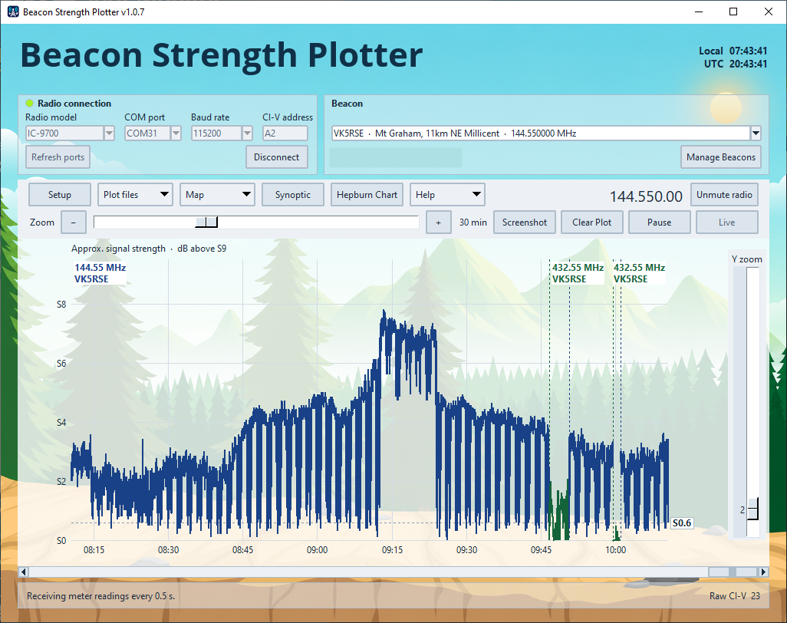
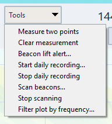

# Beacon Strength Plotter

Beacon Strength Plotter is a Windows 10 and 11 program for monitoring and recording amateur radio beacon signals from Icom transceivers via CI-V. Plot live S-meter readings in S-units or estimated dBm, track changes in propagation, and save recordings for later comparison.

[Download the Windows installer](https://github.com/AM3FS/Beacon-Strength-Plotter/releases/latest) · [Quick Start](docs/Beacon-Plotter-Quick-Start.pdf) · [Operating Guide](docs/Beacon-Plotter-Operating-Guide.pdf)

## New in v1.0.9

- **Measure two points** — Place A and B on the trace to see elapsed time and change in signal level.
- **Beacon lift alerts** — Set an audible alert for a saved beacon frequency when its estimated signal level stays at or above your dBm threshold for a chosen time.
- **Unattended daily recording** — Save dated `.bplot` files to a folder of your choice. Snapshots are written every 30 seconds while samples arrive, with a new file at midnight UTC.
- **Compare saved plots** — Overlay two recordings on a shared frequency, aligned by UTC time of day.
- **Scan beacon frequencies** — Cycle through selected presets with a configurable dwell time. Filter the plot to one frequency to see the gaps while the radio was tuned elsewhere.
- **Plot comments and latest-level guide** — Right-click the trace to add a timestamped comment that stays with the saved plot. Toggle the right-side reading and dotted horizontal guide in **Setup → Y-axis units**.

## Features

- **Live Icom CI-V monitoring** — See signal strength, tuned frequency and connection status. Scroll through up to 24 hours of readings, zoom in on weak signals, pause or return to Live. Set the sampling interval, smoothing and S9 reference.
- **Band colours and frequency markers** — Follow different bands on one plot. Dashed markers identify frequency changes, with the beacon callsign shown when known.
- **Save and share** — Save and reopen plots, export timestamped raw CI-V readings to CSV, or copy a screenshot.
- **Beacon presets and VKSpotter** — Manage colour-coded presets, tune to a saved frequency in CW, and look up or import multiple frequencies from VKSpotter.
- **Distance, bearing and terrain** — Use Maidenhead locators to calculate distance and true bearing. Open the path in **OK1CDJ PathProfile** without a subscription, API key or configuration. **Google Maps and elevation** uses your Google Maps API key and offers KML export.
- **Propagation charts** — Automatically fetch the latest Bureau of Meteorology synoptic chart, use a custom chart image URL, or open your preferred Hepburn forecast.
- **Radio auto-connect** — Discover Windows USB and virtual COM ports and retry after an unexpected connection loss.
- **Display, help and updates** — Show your callsign in the title, choose Day, Night or Auto mode, open the guides from **Help**, and check for new releases in **Setup**.

## Supported Icom radios

Built-in CI-V presets are available for the **IC-905, IC-9700, IC-705, IC-7300, IC-7300MK2, IC-7610 and IC-7760**. For other compatible Icom radios, select **Custom Icom** and enter your radio’s CI-V address.

## Install

Download **VK3FS-Beacon-Strength-Plotter-Setup.exe** from the latest release assets and run it on Windows 10 or 11. Open the Quick Start for radio connection and setup instructions.
