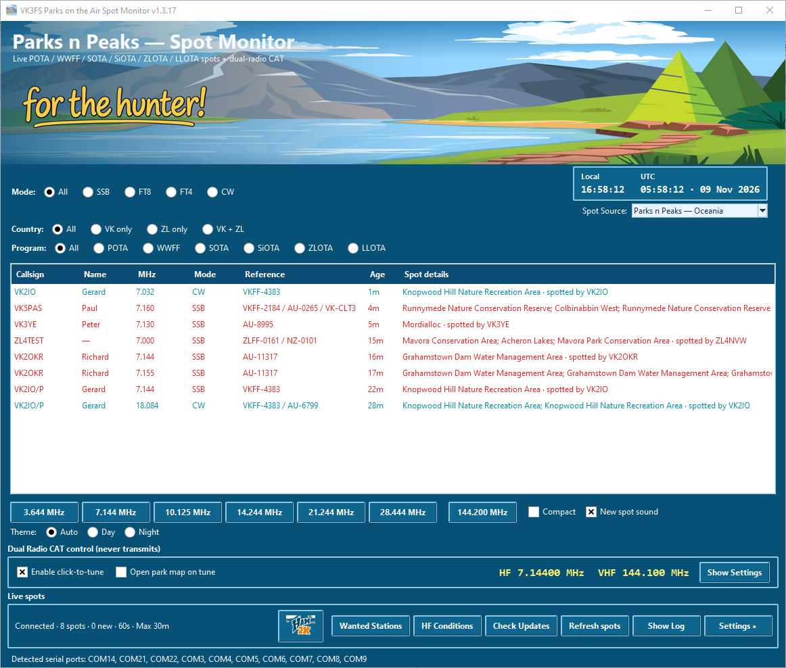

# Parks n Peaks — Spot Monitor

### *For the hunter!*

**Free Windows spot monitoring software for amateur radio hunters**  
*Developed primarily for Australian (VK) and New Zealand (ZL) operators.*

[**Download the latest release**](https://github.com/AM3FS/Parks-n-Peaks-Spot-Monitor/releases/latest) · [**View all releases**](https://github.com/AM3FS/Parks-n-Peaks-Spot-Monitor/releases)

*Live activations, one-click frequency presets and optional dual-radio CAT tuning.*

## What is Parks n Peaks Spot Monitor?

**Parks n Peaks Spot Monitor** is a free Windows application that helps amateur radio **hunters** find and contact portable stations. It brings current spotting information into one easy-to-read window, so you can spend less time checking websites and more time making contacts.

Designed with the **Australian and New Zealand amateur radio community** in mind, it supports hunting activity associated with **POTA, WWFF, SOTA, SiOTA, ZLOTA and LLOTA**. An optional Worldwide spot source broadens the view beyond Oceania.

## Features at a glance

- **Live spots** — automatic updates, spot age, operator callsign, frequency, mode, reference and activation details.
- **Flexible filtering** — choose operating mode, country, program and spot source.
- **Mode-dependent frequency buttons** — separate SSB, CW, FT8 and FT4 preset banks.
- **Dual-radio CAT** — configure HF and VHF/UHF radios independently, with live frequency readouts and optional automatic tuning.
- **Preferred receive filters** — configure SSB and CW filters for supported radios; digital modes use FIL1 (Wide) when supported.
- **Wanted Stations** — maintain a callsign watchlist and hear a distinctive spoken alert when a wanted station appears.
- **Optional QRZ.com lookup** — display an operator's first name when the required QRZ lookup access is configured.
- **HF Conditions** — view live Bureau of Meteorology T Index and ionospheric maps, with links to video explanations.
- **Compact view** — suitable for smaller screens, with Day/Night themes.
- **In-app update checking** — find newer published versions and download the distribution ZIP.

## Supported radio control options

| HF radio / software | VHF/UHF radio |
| --- | --- |
| Icom IC-7300 | Icom IC-9700 |
| Icom IC-7300MK2 | Icom IC-905 |
| Yaesu FTX-1 | — |
| Yaesu FT-891 | — |
| Ham Radio Deluxe (TCP) | — |

*Support and CAT features vary by model. Some profiles have not been verified on physical hardware; consult the user manual. Spot monitoring also works without any radio connected.*

## Download and install

1. Open the **[Latest Release](https://github.com/AM3FS/Parks-n-Peaks-Spot-Monitor/releases/latest)** page.
2. Under **Assets**, download the Windows distribution ZIP (for example, `SpotMon1.3.17.zip`). **Do not choose GitHub's automatic “Source code” ZIP.**
3. **Extract the entire ZIP** to a permanent location on your computer.
4. Open the extracted `ParksPeaksSpotMonitor` folder and run `ParksPeaksSpotMonitor.exe`.
5. Keep the EXE **and all supporting files/folders together**. Create a desktop shortcut to the EXE if you wish.
6. Follow the included **Quick Start Guide** to choose your radio connections and test CAT communications.

**No Python installation or software compilation is required.** An illustrated **User Manual** and **Quick Start Guide** are included in the download.

> **Windows security:** An unfamiliar, unsigned application may trigger a Windows SmartScreen reputation warning. Verify that you downloaded the file from this official repository. Do not disable antivirus protection or ignore an actual malware detection.

## Quick operating tips

- Start by selecting **Oceania** or **Worldwide**, then use Mode, Country and Program filters to narrow the spot list.
- Use **Enable click-to-tune** only when the correct radio connections are configured and you are comfortable with the app changing radio frequencies.
- Double-click a supported spot to tune the appropriate radio; right-click to copy details, open Parks n Peaks, look up the station on QRZ.com or view park details.
- Use **Wanted Stations** to set up a callsign watchlist, and **HF Conditions** for regional propagation graphics.
- Use the **Setup Wizard** under Settings to configure radios and verify read-only CAT frequency reporting.

## Documentation

Both PDF guides are included in each Windows distribution:

- **User Manual** — features, setup, operation, CAT connections and troubleshooting.
- **Quick Start Guide** — getting installed and operating with minimal setup.

## Planned developments

**AUSparks** support is planned once the new Australian program is live and suitable spotting information is available. This feature is **not included** in v1.3.17.

## About this project

Parks n Peaks Spot Monitor is an independent amateur radio utility, developed with feedback from hunters and operators who use SSB, CW and digital modes. It is offered **free of charge**. Feedback about radio compatibility, bugs and usability is welcome through the repository's [Issues](https://github.com/AM3FS/Parks-n-Peaks-Spot-Monitor/issues) page.

**Disclaimer:** The software is supplied *as is*, without warranty or guarantee of operation or compatibility with particular computers, radios or configurations. Installation and use are at your own risk. CAT control is intended for frequency and mode selection, **not transmission**.

---

**Parks n Peaks Spot Monitor — for the hunter!**  
[Get the latest version](https://github.com/AM3FS/Parks-n-Peaks-Spot-Monitor/releases/latest)

