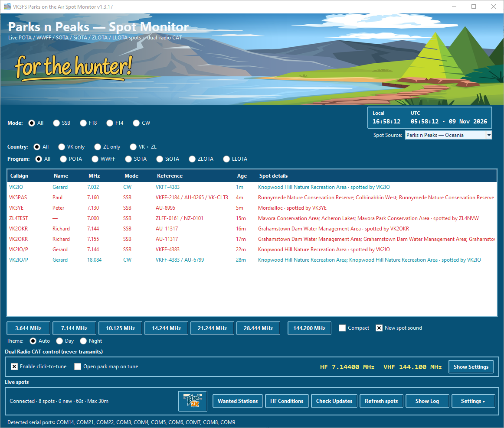
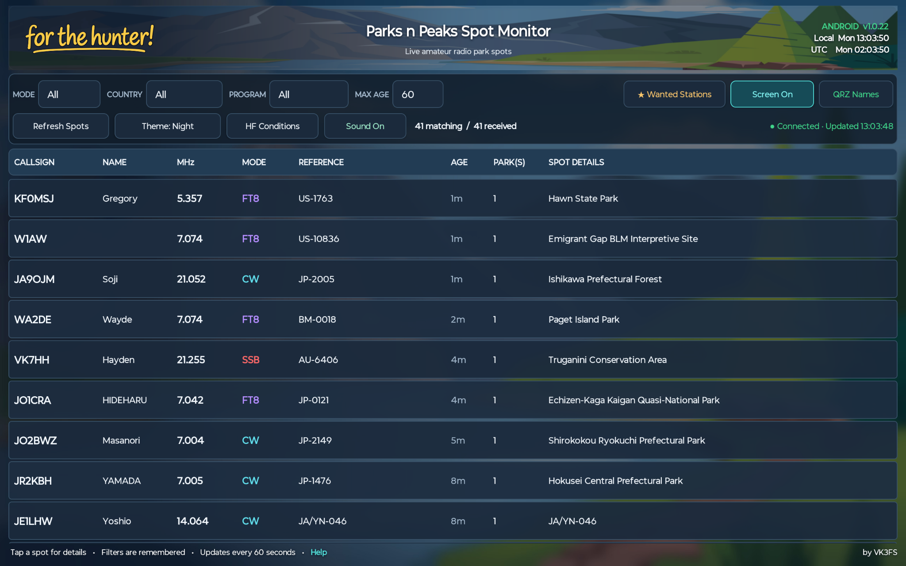
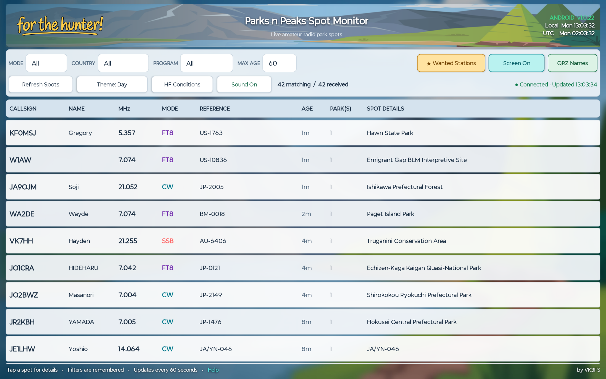

# Parks n Peaks — Spot Monitor

### *For the hunter!*

**Free Windows and Android spot monitoring software for amateur radio hunters**  
*Originally developed for Australian (VK) and New Zealand (ZL) operators, with worldwide spotting support.*

**[Windows releases](https://github.com/AM3FS/Parks-n-Peaks-Spot-Monitor/releases/latest)** · **[All releases (Windows & Android)](https://github.com/AM3FS/Parks-n-Peaks-Spot-Monitor/releases)**

*Live activations, easy-to-use filters, optional Windows dual-radio CAT tuning, and Android tablet monitoring.*

## What is Parks n Peaks Spot Monitor?

**Parks n Peaks Spot Monitor** is free software that helps amateur radio **hunters** find and contact portable stations. It brings current spotting information into one easy-to-read display, so you can spend less time checking websites and more time making contacts.

Available in two versions:

- **Windows** — the full desktop Spot Monitor, including frequency presets and optional dual-radio CAT control.
- **Android tablet** — a standalone, landscape-oriented spot display with filtering, QRZ operator names, Wanted Stations and audible alerts. No PC or radio connection is required.

Designed with the **Australian and New Zealand amateur radio community** in mind, the application supports hunting activity associated with **POTA, WWFF, SOTA, SiOTA, ZLOTA and LLOTA**. Worldwide spotting is also available.

---

## Windows version

### Features at a glance

- **Live spots** — automatic updates, spot age, operator callsign, frequency, mode, reference and activation details.
- **Flexible filtering** — choose operating mode, country, program and spot source.
- **Mode-dependent frequency buttons** — separate SSB, CW, FT8 and FT4 preset banks.
- **Dual-radio CAT** — configure HF and VHF/UHF radios independently, with live frequency readouts and optional automatic tuning.
- **Preferred receive filters** — configure SSB and CW filters for supported radios; digital modes use FIL1 (Wide) when supported.
- **Wanted Stations** — maintain a callsign watchlist and hear a distinctive spoken alert when a wanted station appears.
- **Optional QRZ.com lookup** — display an operator's first name when the required QRZ lookup access is configured.
- **HF Conditions** — view live Bureau of Meteorology T Index and ionospheric maps, with links to video explanations.
- **Compact view** — suitable for smaller screens, with Day/Night themes.
- **In-app update checking** — find newer published versions and download the distribution ZIP.

### Supported radio control options

| HF radio / software | VHF/UHF radio |
| --- | --- |
| Icom IC-7300 | Icom IC-9700 |
| Icom IC-7300MK2 | Icom IC-905 |
| Yaesu FTX-1 | — |
| Yaesu FT-891 | — |
| Ham Radio Deluxe (TCP) | — |

*Support and CAT features vary by model. Some profiles have not been verified on physical hardware; consult the user manual. Spot monitoring also works without any radio connected.*

### Windows download and install

1. Open the **[Windows Latest Release](https://github.com/AM3FS/Parks-n-Peaks-Spot-Monitor/releases/latest)** page. If this link leads to an Android release, use **[All Releases](https://github.com/AM3FS/Parks-n-Peaks-Spot-Monitor/releases)** and select the latest Windows release.
2. Under **Assets**, download the Windows distribution ZIP (for example, `SpotMon1.3.17.zip`). **Do not choose GitHub's automatic “Source code” ZIP.**
3. **Extract the entire ZIP** to a permanent location on your computer.
4. Open the extracted `ParksPeaksSpotMonitor` folder and run `ParksPeaksSpotMonitor.exe`.
5. Keep the EXE **and all supporting files/folders together**. Create a desktop shortcut to the EXE if you wish.
6. Follow the included **Quick Start Guide** to choose your radio connections and test CAT communications.

**No Python installation or software compilation is required.** An illustrated **User Manual** and **Quick Start Guide** are included in the download.

> **Windows security:** An unfamiliar, unsigned application may trigger a Windows SmartScreen reputation warning. Verify that you downloaded the file from this official repository. Do not disable antivirus protection or ignore an actual malware detection.

### Quick operating tips

- Start by selecting **Oceania** or **Worldwide**, then use Mode, Country and Program filters to narrow the spot list.
- Use **Enable click-to-tune** only when the correct radio connections are configured and you are comfortable with the app changing radio frequencies.
- Double-click a supported spot to tune the appropriate radio; right-click to copy details, open Parks n Peaks, look up the station on QRZ.com or view park details.
- Use **Wanted Stations** to set up a callsign watchlist, and **HF Conditions** for regional propagation graphics.
- Use the **Setup Wizard** under Settings to configure radios and verify read-only CAT frequency reporting.

### Windows documentation

Both PDF guides are included in each Windows distribution:

- **User Manual** — features, setup, operation, CAT connections and troubleshooting.
- **Quick Start Guide** — getting installed and operating with minimal setup.

---

## Android tablet version

**Parks n Peaks Spot Monitor for Android** is a standalone, landscape-only tablet application for monitoring live amateur radio park and summit spots. It does not require a Windows PC or a radio connection.

Designed and tested primarily on the **Lenovo TB336FU 11-inch Android tablet**, with a responsive layout intended for other landscape tablets. A separate phone interface is not currently provided.

### Android screenshots

**Night theme — worldwide spots**

**Day theme — worldwide spots**

### Android features

- **Live worldwide Parks n Peaks spots**, automatically refreshed every 60 seconds, with manual refresh and refresh when the app becomes active again.
- **Filters** for Mode, Country, Program and maximum spot age; selections are remembered.
- **QRZ operator names**, when the user configures eligible QRZ lookup access.
- **Wanted Stations** callsign watchlist, amber highlighting and optional audible alert.
- **New-spot notification** using a gong sound; **Sound Off** acts as a master mute for all alerts.
- **Day and Night themes**, with optional automatic switching.
- **Screen On / Screen Auto** control to prevent normal screen timeout while monitoring.
- **HF Conditions** maps, plus spot details, Copy Spot and **Show on Map** in a web browser when a valid park link is available.
- **FT8 dial-frequency correction** within ±2 kHz, marked with an asterisk, and subtle highlighting of very recent spots.
- **Built-in Help & About**, available through the footer Help link.

### Android download and install

**[Browse all releases and find the latest Android APK](https://github.com/AM3FS/Parks-n-Peaks-Spot-Monitor/releases)**

> **Android APK publication pending.** This section is ready for the upcoming `android-v1.0.22` release. The Android application is not downloadable from GitHub until a signed APK has been attached to that release.

1. Open **[Releases](https://github.com/AM3FS/Parks-n-Peaks-Spot-Monitor/releases)** and choose the latest release whose title begins **Android** (for example, *Android v1.0.22*).
2. Under **Assets**, download the `.apk` file. **Do not select GitHub's automatically generated “Source code” ZIP.**
3. Transfer the APK to your Android tablet, if needed.
4. Open it in the tablet's Files app and allow installation from that source if Android asks.
5. Tap **Install**, then **Open**. The app is intended for **landscape tablets**.
6. Set your filters and optionally configure QRZ Names and Wanted Stations.

*The first publicly signed APK may not install over an earlier debug-signed testing build. If Android reports a signature conflict, back up any settings you need before uninstalling the old testing version and installing the public APK.*

### Android source code and help

- **[Android Studio source](android/)** — source code for the tablet application.
- **[Installation and usage guide](docs/)** — additional documentation and release notes.
- Tap **Help** at the bottom-left of the running Android app for descriptions of its controls and functions.

---

## Planned developments

**AUSparks** support is planned once the new Australian program is live and suitable spotting information is available. This feature is **not included in the currently documented Windows v1.3.17 release**. Platform-specific feature availability may differ.

## About this project

Parks n Peaks Spot Monitor is an independent amateur radio utility, developed with feedback from hunters and operators who use SSB, CW and digital modes. It is offered **free of charge**. Feedback about radio compatibility, bugs and usability is welcome through the repository's [Issues](https://github.com/AM3FS/Parks-n-Peaks-Spot-Monitor/issues) page.

More information: **[3fs.net.au](https://3fs.net.au/)**.

**Disclaimer:** The software is supplied *as is*, without warranty or guarantee of operation or compatibility with particular computers, radios or configurations. Installation and use are at your own risk. Windows CAT control is intended for frequency and mode selection, **not transmission**. The Android application does not provide CAT control.

---

**Parks n Peaks Spot Monitor — for the hunter!**  
[View Windows and Android releases](https://github.com/AM3FS/Parks-n-Peaks-Spot-Monitor/releases)

